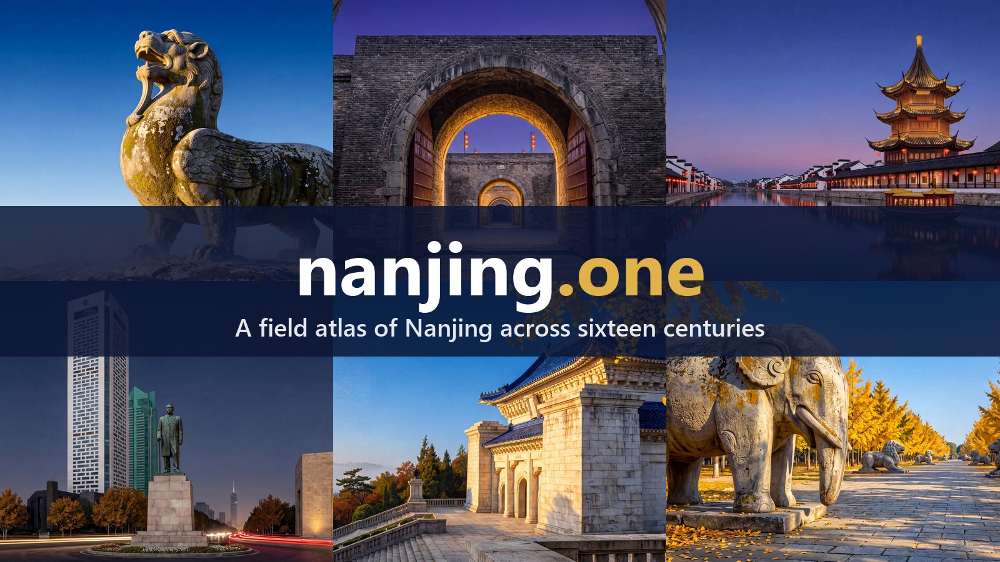

# nanjing.one · Across sixteen centuries of Jinling

**Live Site**: https://nanjing.one/  
**Illustrated Pixel Map**: https://nanjing.one/map/  
**Spoken Chinese Phrasebook**: https://nanjing.one/say/

An interactive scroll chronicle, illustrated city atlas, metro route guide, film-location reference, and spoken phrasebook for **Nanjing (Jinling)** in **English**, **Spanish (Español)**, and **Japanese (日本語)**. Free, no ads, and no login required to explore.

---

## What Is Inside

- **Interactive Visual Chronicle (`/`)**: Scroll across historic landmarks from the 518 CE stone Bixie at the Xiao Xiu Tomb, Xuanwu Lake, Purple Mountain, Ming City Wall, and Niushou Dome to midnight Xinjiekou.
- **Illustrated Isometric Map (`/map/`)**: Zoomable and pannable city map highlighting major landmarks, rivers, and metro connections across Nanjing.
- **Say It in Chinese (`/say/`)**: 23 everyday Mandarin phrases plus local Nanjing dialect (`阿要辣油啊`), each paired with pinyin, English/Spanish/Japanese tips, and timestamped YouTube clips (`https://nanjing.one/say/<slug>/`).
- **Real-Time Presence Cursors**: Live visitor presence dots built on Cloudflare Workers and Durable Objects so visitors exploring at the same moment can see where others are looking on the map and timeline.
- **Structured Open Reference (`nanjing-facts.json`)**: 12 curated landmarks, 9 seasonal photography spots, 7 verified Nanjing film locations, 1-day & 2-day metro itineraries, and 9 traveler FAQs.

---

## Quick Links

| Resource | URL |
|---|---|
| Main Atlas & Timeline | https://nanjing.one/ |
| Illustrated City Map | https://nanjing.one/map/ |
| Spoken Chinese Phrasebook (23 Phrases) | https://nanjing.one/say/ |
| Open Travel Data (JSON) | [./nanjing-facts.json](./nanjing-facts.json) |
| Phrasebook Directory (Markdown) | [./phrases-index.md](./phrases-index.md) |
| Privacy & Credits | https://nanjing.one/privacy/ |

---

## Key Landmarks & Routes Included

1. **Sun Yat-sen Mausoleum (中山陵)** · Metro Line 2 (`Muxuyuan` / `Xiamafang`)
2. **Ming Xiaoling Mausoleum (明孝陵)** · UNESCO Ming imperial tomb & Elephant Road
3. **Confucius Temple & Qinhuai River (夫子庙与秦淮河)** · Blue-hour canal & lanterns
4. **Xuanwu Lake (玄武湖)** · Dawn reflections beside the Ming City Wall
5. **Nanjing City Wall & Zhonghua Gate (南京城墙·中华门)** · Premier sunset battlements
6. **Presidential Palace (总统府)** · Six centuries of political architecture
7. **Nanjing Museum (南京博物院)** · Free real-name booking required (closed Mondays)
8. **Jiming Temple (鸡鸣寺)** · Late March to early April cherry blossoms
9. **Yuejiang Tower (阅江楼)** · Yangtze River & bridge views atop Lion Mountain
10. **Niushou Mountain Cultural Park (牛首山)** · Usnisa Palace subterranean sanctuary
11. **Nanjing Massacre Memorial Hall (侵华日军南京大屠杀遇难同胞纪念馆)** · Historical memorial
12. **Porcelain Tower & Great Bao'en Temple Park (大报恩寺遗址公园)** · Ming site & glass pagoda

---

## Architecture Highlights

- **Frontend**: TypeScript, Vite, WebGL canvas particle transitions, responsive scroll narrative
- **Edge & Real-Time**: Cloudflare Workers + Cloudflare Durable Objects (WebSocket presence room) + D1
- **SEO & Accessibility**: Multilingual `<noscript>` fallback, Schema.org (`WebSite`, `TouristDestination`, `FAQPage`), static `/say/` generator, and XML sitemap

---

## License

Structured documentation and reference metadata in this showcase repository are shared under the [MIT License](./LICENSE). Interactive artwork, city illustrations, and site media remain copyrighted on [nanjing.one](https://nanjing.one/).
